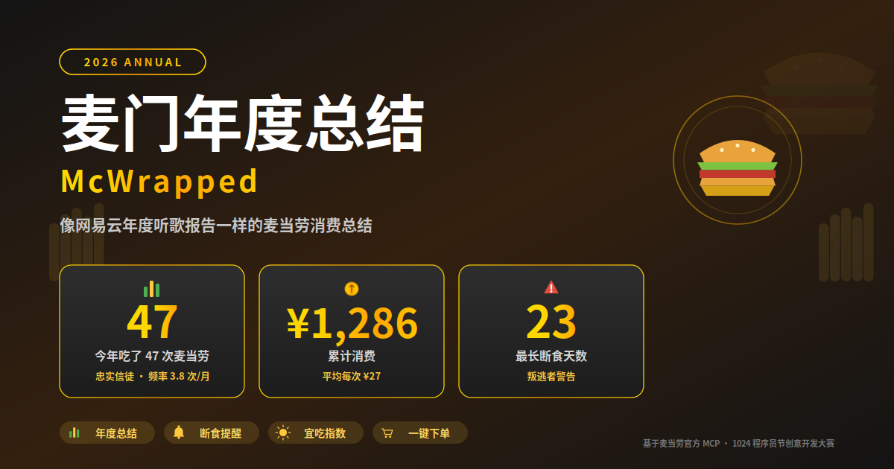

<div align="center">
  
</div>

<div align="center">

# 🍟 McDonald's Annual Wrapped · McWrapped

**Powered by the official McDonald's MCP — turning your real orders into an annual report**

[中文](README.md) · **English**

**[🌐 Live Demo](https://qingyebenye-tech.github.io/mcd-yearly/)** — No installation required

[Quick Start](#-quick-start) · [Examples](#-examples) · [Features](#-features) · [How It Works](#-how-it-works) · [FAQ](#-faq) · [Changelog](CHANGELOG.md)

[](LICENSE)
[](https://open.mcd.cn/mcp)
[](https://github.com/M-China/mcd-developer-innovation-challenge)

</div>

---

## 💡 Why This Project

**47 Big Macs. ¥1,286 spent. 23 consecutive days without a single McDonald's order.** — You can't remember these numbers, but the AI can.

McDonald's China has opened up real order history, loyalty points, coupons, and campaign data through an official MCP (Model Context Protocol) server. Instead of letting that data sit in a backend dashboard, this Skill turns it into a **ceremonial annual bill**: how many times you ate, how much you spent, your go-to item, and how long you've been away — all at a glance.

What this Skill does is simple: **translate your real orders into an annual report worth screenshotting and sharing.**

> You don't need to remember. Just ask.

---

## ✨ Features

| Module | Description |
|:---:|---|
| 📊 **Annual Wrapped** | Total visits, total spend, favorite item, peak month, most active weekday, longest streak, longest fast |
| 🔔 **Fast Alert** | Auto-reminder if you haven't eaten McDonald's in 7+ days; red warning at 14+ days |
| 🌤️ **Daily Crave Index** | A 0–100 score combining fast duration, today's campaigns, expiring coupons, and weekday |
| 🍔 **One-Tap Order** | Recommends what to eat today, can check price and create an order directly |
| ⏰ **Next Visit Reminder** | Estimates your "due back" window based on historical consumption frequency |

### 🏅 McFaith Index Tiers

The annual report assigns you a title based on your McFaith score:

| Score | Title | Interpretation |
|:---:|---|---|
| 90–100 | McSupreme Believer | Skip McDonald's today and you'll lose karma |
| 70–89 | McDevoted Follower | Devotion is solid, keep it up |
| 50–69 | McFence Sitter | Could eat, could not — depends on the mood |
| 30–49 | McDefector | Time to come back for a burger |
| 0–29 | McProdigal | Go eat a burger and redeem yourself |

### 🎨 Live Demo

No installation required — **[just open the link](https://qingyebenye-tech.github.io/mcd-yearly/)**. The demo page provides 3 interactive tabs:

| Tab | Content |
|:---:|---|
| 📊 Annual Report Card | 12 inputs render a dark gold-themed card in real time, with auto-calculated McFaith Index + title |
| 🌤️ Daily Crave Index | 4 parameters compute a 0–100 score live, with weighted-factor visualization |
| ⚙️ How It Works | 8 MCP tool tags + call flow diagram + read/write separation principle |

Visitors need zero environment setup to run the core algorithms in the browser and understand how the 8 MCP tools collaborate — ideal for judges and potential users to experience the product value quickly.

---

## 🚀 Quick Start

### Step 1: Get Your MCP Token

Visit the [McDonald's MCP Portal](https://open.mcd.cn/mcp):

```
Log in with phone → Console → Activate → Accept terms → Copy Token
```

### Step 2: Configure MCP

Replace `${MCD_MCP_TOKEN}` in `mcp-config.example.json` with your token, then paste into your MCP client (WorkBuddy / Cursor / Cherry Studio / Claude Code, etc.):

```json
{
  "mcpServers": {
    "mcd-mcp": {
      "type": "streamablehttp",
      "url": "https://mcp.mcd.cn",
      "headers": {
        "Authorization": "Bearer ${MCD_MCP_TOKEN}"
      }
    }
  }
}
```

> You can also inject via environment variable to avoid writing the token to disk: `export MCD_MCP_TOKEN=your_token_here`

### Step 3: Load the Skill

Load [`SKILL.md`](SKILL.md) as a system prompt / Skill file in your AI client, then simply ask:

- "Show me my McDonald's annual wrapped"
- "How many times did I eat McDonald's this year?"
- "Should I eat McDonald's today?"

> For detailed setup steps, see [workbuddy.md](workbuddy.md) (WorkBuddy-specific) or [MCP_INTEGRATION.md](MCP_INTEGRATION.md).

---

## 💬 Examples

**Input:**

```
看看我的麦门年度总结
```

**Output:**

```
🍟 2026 McDonald's Annual Wrapped
━━━━━━━━━━━━━━━━━━━━━━━━━━━━
📅 You ate McDonald's 47 times this year
💰 Total spend: ¥1,286 (avg ¥27 per visit)
🏆 Your favorite: Big Mac (ordered 12 times)
📈 Peak month: July (9 visits)
📅 Most active day: Friday
⏳ Longest fast: 23 days
📊 Days since last McDonald's: X
🎫 Coupons on hand: 3
⭐ Current points: 2,350
🏅 McFaith Index: 87 — McDevoted Follower
━━━━━━━━━━━━━━━━━━━━━━━━━━━━
```

**Then input:**

```
今天宜吃麦当劳吗
```

**Output:**

```
🌤️ Daily McD Briefing (Oct 25, Sun)
━━━━━━━━━━━━━━━━━━━━━━━━━━━━
Crave Index: 92%  🔥 Highly Recommended
Today's pick: Spicy Chicken Sandwich Combo (6-piece Nuggets + McNuggets)
Reasons:
  1. You haven't had McDonald's in 9 days (weight 30%)
  2. Today's "Programmers' Day" double combo campaign (weight 25%)
  3. Your "BOGO coupon" expires the day after tomorrow (weight 25%)
  4. Sunday chill day — comfort food mode activated (weight 20%)
━━━━━━━━━━━━━━━━━━━━━━━━━━━━
Want me to place the order? Reply "order"
```

---

## ⚙️ How It Works

```
Annual Wrapped                           Daily Crave
   │                                      │
   ├─ order-list        Fetch orders      ├─ order-list        Fast duration
   ├─ query-my-account  Check points      ├─ campaign-calendar Today's deals
   └─ query-my-coupons  Check coupons     └─ query-my-coupons  Expiring coupons
   │                                      │
   └─► Stats + McFaith tiering           └─► Weighted 0–100 Crave Index
   │                                                  │
   └─► Output report ─────────────────────► On confirm → query-meals
                                                       → calculate-price
                                                       → create-order
```

**Every number comes from the real McDonald's MCP response** — no fabrication, no hallucination. If a tool call fails, the Skill gracefully degrades using available data without breaking the flow.

---

## 🎯 Target Users

- 🍟 **McDonald's Loyalists** — Want to know exactly how much they spent this year
- 📊 **Data Enthusiasts** — Love the ritual of annual reports and data-driven storytelling
- 💸 **Bargain Hunters** — Want to track coupon usage and fast duration
- 🤖 **AI Agent Developers** — Want to learn how to wrap MCP capabilities into a human-friendly product

---

## 📁 Project Structure

```
mcd-yearly/
├── SKILL.md                 # Skill body (prompt + workflow definition)
├── README.md                # Chinese README
├── README_EN.md             # English README (this file)
├── MCP_INTEGRATION.md       # MCP integration docs (tool list / flow / business value)
├── CONTEST_DECLARATION.md   # Contest declaration (official, do not modify)
├── CHANGELOG.md             # Changelog
├── mcp-config.example.json  # MCP client config template (sanitized)
├── workbuddy.md             # WorkBuddy usage & dev context
├── demo/
│   └── index.html           # Interactive online demo page
├── docs/
│   └── index.html           # GitHub Pages deployment copy
├── images/
│   ├── banner.png           # Project hero image
│   └── banner.svg           # Hero image vector source
├── LICENSE                  # MIT License
└── .gitignore
```

---

## 🔐 Security

- Tokens are **injected via environment variable `${MCD_MCP_TOKEN}` only** — no real tokens, keys, or PII are stored in this repo
- Config files use environment variable placeholders, complying with contest data-safety requirements
- All business data is fetched in real time from McDonald's MCP — nothing is stored or cached locally
- Write operations (ordering, claiming coupons) require explicit user confirmation

---

## 📄 License

[MIT](LICENSE) © 2026 McDonald's Annual Wrapped contributors

---

## ⚠️ Disclaimer

This project is an entry in the **McDonald's 1024 Programmers' Day Creative Development Contest**, independently developed by the contestant. It is **not an official McDonald's product** and has no affiliation with or endorsement by McDonald's Corporation.

Project outputs are for entertainment purposes only and **do not constitute medical, nutritional, or other professional advice**. Product information, pricing, and availability are subject to real-time results from official McDonald's channels. All trademarks belong to their respective owners.

---

<div align="center">
  <sub>If this report makes you want to order a Big Mac — remember, the data is real, and so is your wallet.</sub>

  <br><br>
  <a href="#-quick-start">↑ Back to top</a>
</div>
